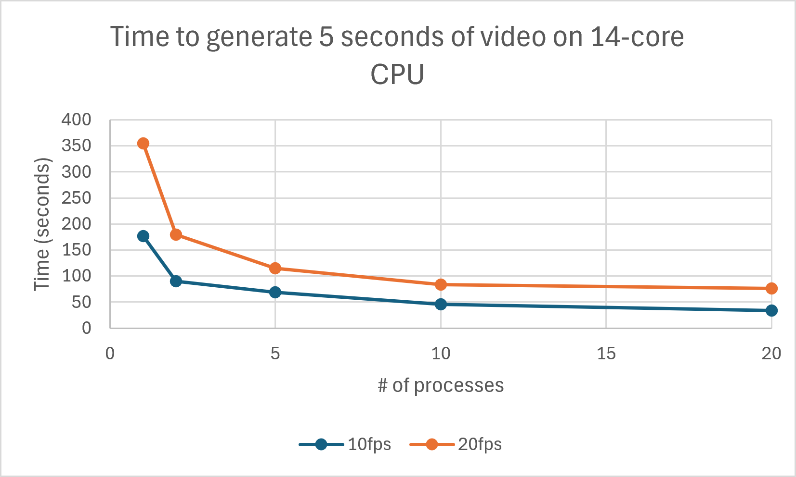

# Mandelbrot Visualizer

This project is for creating videos of the mandlebrot set.

## Execution
Edit `batch_runner.c` to have your desired constants. Most important on top:
```
FOCAL_X -1.40116569029
    The x-coordinate to zoom in towards
DECAY_RATE .75
    The amount of zoom per frame, scaled proportianally to the last frame. Make this above 1 to have the video zoom out
N_IMGS 50
    The number of frames to generate
VIDEO_LENGTH 5 
    The numbers of seconds for the video to last. N_IMGS divided by this will be the framerate

DEFAULT_SCALE 4
    The first frame will cover [-this/2, this/2]. Keep at 4 to start at a picture of the whole set
DEFAULT_N_PROCS 1
    Number of processes to use if it is not passed in as an argument
```

If you haven't already,
```bash
sudo apt install ffmpeg
sudo apt install libjpeg-dev
```

Then, run the program
```bash
make
./mandel [-p <num>]
```
where `<num>` is how many processes to use. The resulting video file will be named "mandel....mpg" with the framerate listed.

## Implementation Details
To run multiprocessing, the program uses a semaphore to track the number of processes that need to be dispatched. The parent runs in a loop, pulling the semaphore and dispatching a child to compute one image. When the child finishes, it posts back to the semaphore so another can be dispatched in its place.

## Results
Increasing the number of processes approximately inversly scales the runtime, except minimal gains going past the number of processors on the CPU (14). The 20fps runs took over double to time on each # of processors despite being exactly double the amount of images.
